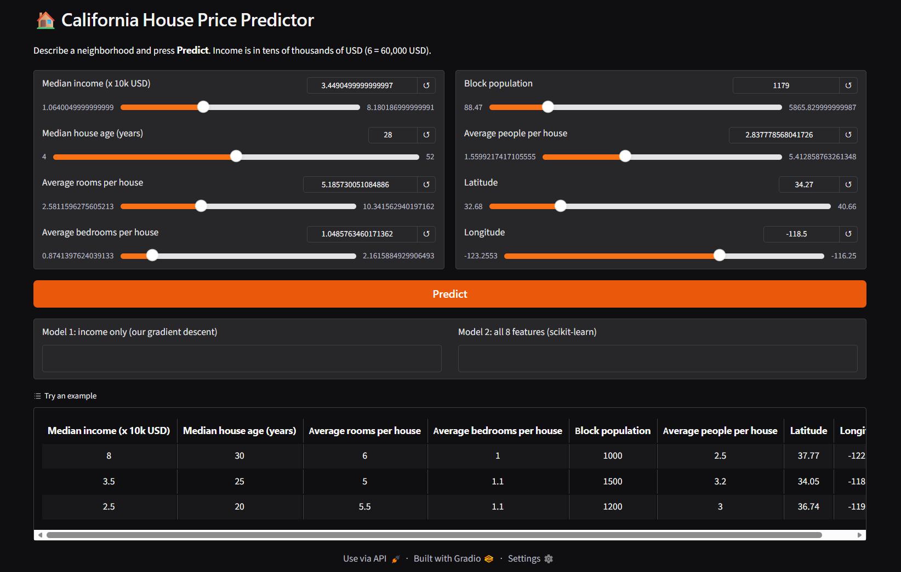

# 🏠 California House Price Prediction

Linear regression built **from scratch** (cost function + gradient descent in NumPy), compared against scikit-learn, and served through a small **Gradio** web app.

Built while following the *Linear Regression with One Variable* lecture of Andrew Ng's [Machine Learning Specialization](https://www.coursera.org/specializations/machine-learning-introduction).

[](https://colab.research.google.com/github/abdelrahmaannnn/california-house-price-prediction/blob/main/house_price_linear_regression.ipynb)

## What's inside

| File | Description |
|---|---|
| `house_price_linear_regression.ipynb` | Step-by-step notebook: EDA, model, cost function, gradient descent, evaluation, multiple regression and the Gradio app |
| `app.py` | Standalone Gradio app (trains both models on startup, then serves the UI) |
| `requirements.txt` | Python dependencies |

## Approach

1. **Data:** [California Housing](https://scikit-learn.org/stable/datasets/real_world.html#california-housing-dataset) (1990 US Census, 20,640 block groups). Rows with capped prices (≥ 500,000 USD) are removed.
2. **Feature selection:** `MedInc` (median income) has the strongest correlation with price.
3. **Model:** $f_{w,b}(x) = wx + b$
4. **Cost function:** $J(w,b) = \frac{1}{2m} \sum_{i=1}^{m} \left( f_{w,b}(x^{(i)}) - y^{(i)} \right)^2$
5. **Gradient descent** from scratch with simultaneous updates ($\alpha = 0.01$, 10,000 iterations).
6. **Evaluation** on a held-out 20% test set with MAE, RMSE and R².
7. **Bonus:** multiple linear regression on all 8 features with `StandardScaler`.

## Results (test set)

| Model | w | b | R² | MAE |
|---|---|---|---|---|
| Gradient descent (from scratch), income only | 0.3994 | 0.4511 | 0.411 | ≈ 57,300 USD |
| scikit-learn `LinearRegression`, income only | 0.3994 | 0.4511 | 0.411 | ≈ 57,300 USD |
| scikit-learn, all 8 features (scaled) | – | – | 0.569 | ≈ 48,300 USD |

The from-scratch gradient descent converges to the same parameters as scikit-learn.

## Run it

**In Colab:** click the badge above, then *Runtime → Run all*. The last cell launches the app and prints a public `gradio.live` link.

**Locally:**

```bash
git clone https://github.com/abdelrahmaannnn/california-house-price-prediction.git
cd california-house-price-prediction
pip install -r requirements.txt
python app.py          # open http://127.0.0.1:7860
```

## The app



Move the sliders (or pick an example: San Francisco, Los Angeles, Fresno) and press **Predict**. It shows two predictions side by side:

- **Model 1** uses income only, so changing the location doesn't affect it.
- **Model 2** uses all 8 features, so moving from the coast to an inland city changes the price.

## Tech

Python · NumPy · pandas · Matplotlib · scikit-learn · Gradio
